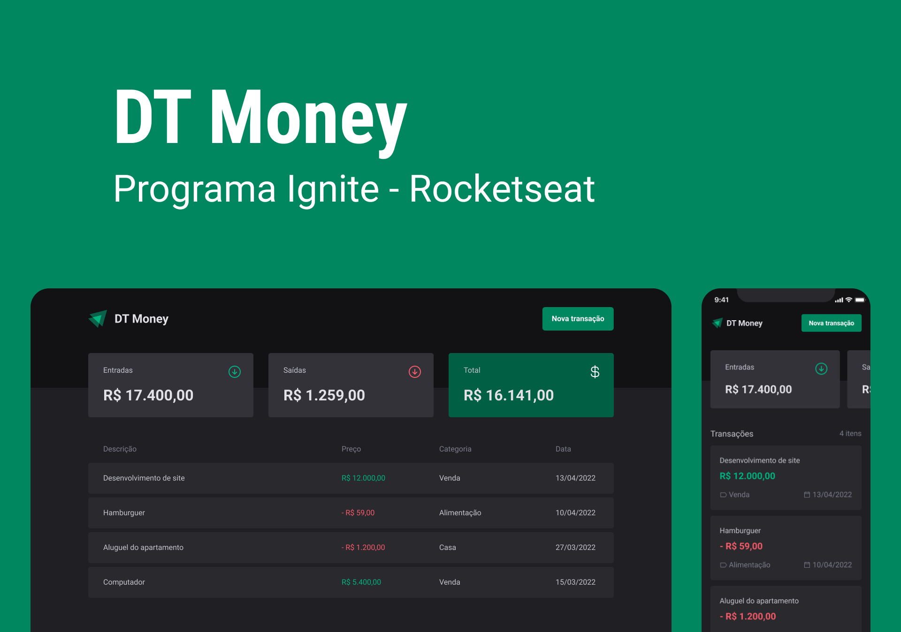
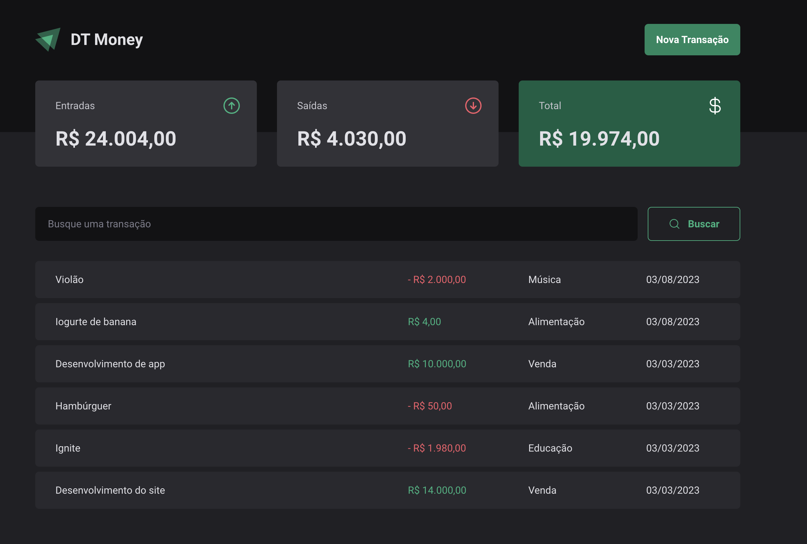

<p align="center">
  <a href="#-tecnologias">Tecnologias</a>&nbsp;&nbsp;&nbsp;|&nbsp;&nbsp;&nbsp;
  <a href="#-projeto">Projeto</a>&nbsp;&nbsp;&nbsp;|&nbsp;&nbsp;&nbsp;
  <a href="#-como-executar">Como executar</a>&nbsp;&nbsp;&nbsp;|&nbsp;&nbsp;&nbsp;
</p>

<p align="center">
  
  
</p>

<br>

## ✨ Tecnologias

Esse projeto foi desenvolvido com as seguintes tecnologias:

- [Vite](https://vitejs.dev/)
- [React](https://reactjs.org)
- [Radix](https://www.radix-ui.com/)
- [React Hook Form](https://react-hook-form.com/)
- [TypeScript](https://www.typescriptlang.org/)

## 💻 Projeto

O Ignite DT Money é um aplicativo criado com o propósito de facilitar o estudo e compreensão de conceitos como Context API, React Hook Form, consumo de API, Styled Components, entre outros. O projeto foi desenvolvido com o objetivo de criar um Sistema de Finanças Pessoais.

## 🚀 Como executar

- Clone o repositório
- Instale as dependências com `npm`
- Inicie o servidor com `npm dev`

## Como executar o JSON Server

```bash
  npm run server
```

Agora você pode acessar [`localhost:3000`](http://localhost:3000) do seu navegador.
